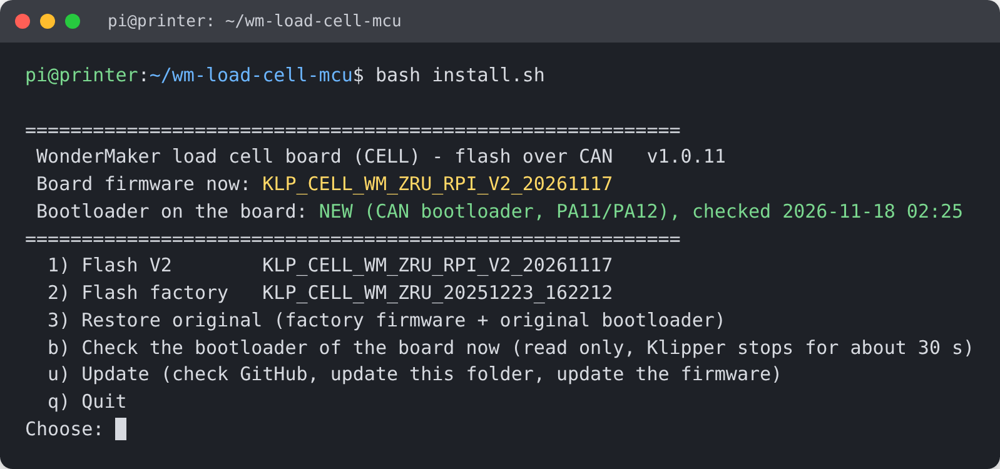
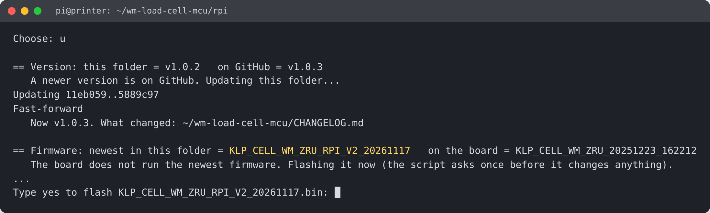

# wm-load-cell-mcu

  

Firmware and flash tools for the **load cell board (CELL)** of the **WonderMaker ZR Ultra-S** and the **WonderMaker ZR Ultra**.

**Where is the board?** The load cell MCU board (`[mcu CELL]` in Klipper) is located **under the heated bed**. It is the board that reads the load cell used by the tool setter and the nozzle touch (offset calibration). This repo is only for that board. Nothing here changes the main board, the toolhead boards or the screen board.

- Flash the patched firmware **V2**, or go back to the **original factory firmware**, over CAN.
- **No SWD programmer, no Pico, no ST-Link, no wires, no soldering.** Everything runs from the printer's Raspberry Pi, or from the WonderMaker factory screen board, over the normal CAN cable.

**Version 1.0.15** (2026-11-18). See [`VERSION`](VERSION) and [`CHANGELOG.md`](CHANGELOG.md). Credit: ducati1198.

> ## ⚠️ Warning: read this first
>
> **Use this at your own risk. The author (ducati1198) is not responsible for any damage**, including a load
> cell board that no longer starts, a damaged printer, lost prints, lost data or loss of warranty. This is a
> community project. It is **not** from WonderMaker and has no support from them. It comes with no warranty
> of any kind (see the GPLv3 licence). It was tested on **one** board only (a ZR Ultra-S), driven from a Raspberry Pi and from the factory screen board.
>
> ### 🔌 Do not lose power while it writes
>
> The first time, the tool replaces the board's bootloader. It takes about 1 to 4 seconds (longer on the factory screen board). **If the printer loses
> power, is switched off, is unplugged, or the board resets while the tool is writing, the board can stop
> starting for good.** Only a hardware probe on the SWD pads can bring it back (see [Rescue](#rescue-with-a-probe)).
>
> - Do not switch off, unplug or touch the printer, and do not reboot the Pi, until the tool says it is finished.
> - Use stable power. Do not do this during a storm or when the power is unstable. A UPS is a good idea.
> - Do not close the SSH window in the middle of a write. Use `screen` or `tmux` if your connection is weak.
> - Never start it while the printer is printing, heating or moving.
> - Keep the Pico rescue kit (see below) in mind if you cannot afford a dead board.

---

## What V2 fixes

The factory firmware (`KLP_CELL_WM_ZRU_20251223_162212`) sometimes reads the load cell chip while the chip is
already preparing its next sample. That gives a broken value, and a broken value can look like a touch.
On the test printer this showed up as false touches and retries during the tool offset calibration.

V2 (`KLP_CELL_WM_ZRU_RPI_V2_20261117`) waits for a fresh sample before it reads.

| On the test printer | Factory firmware | V2 |
|---|---|---|
| Broken reads, no motion | about 20 in 1900 | 0 in 5200 |
| Retries in a full offset run (240 touches) | about 19 in one run, 5 in another | 0 in two runs |

*(The retry numbers of the factory firmware were counted from the console during the runs; the nozzle tips were not checked for residue in those runs. The broken-read test needs no nozzle and is the better number.)*

V2 is the factory firmware with that one change. Nothing else is different.

## Why a normal CAN flash does not work on this board

The factory **bootloader** of the load cell board listens for CAN on pins PB8/PB9. The board is wired to
PA11/PA12. So the bootloader can never hear the Pi, and the usual "flash over CAN" fails (the board then stays
silent until the printer is powered off and on).

This repo solves it in software. The running firmware does talk on the right pins and has Klipper's
`debug_read` / `debug_write` commands. The tool `zr-ultra/tools/cell_bl_soft.py` uses them to replace the
bootloader with one that uses PA11/PA12 (same CAN id as before). After that, flashing over CAN works.

## Which printers

| Printer | Status |
|---|---|
| WonderMaker **ZR Ultra-S** | Tested (one printer, from a Raspberry Pi and from the factory screen board) |
| WonderMaker **ZR Ultra** | Meant to work too, **not tested**. The tool checks the firmware name, the chip and the flash size and stops without changing anything if the board is not the one it knows. |

## What you need

**No special hardware.** You do **not** need an SWD programmer (ST-Link, J-Link, Pico or similar) and you do not open the board.

- A WonderMaker ZR Ultra-S or ZR Ultra **run by a Raspberry Pi**, or by the **WonderMaker factory screen board** (the factory image), with Klipper in `~/klipper` and `~/klippy-env`.
- The CAN interface `can0` up, and `[mcu CELL]` with its `canbus_uuid` in `~/printer_data/config`.
- The load cell board running `KLP_CELL_WM_ZRU_20251223_162212` or V2. The tool stops by itself on anything else.
- The printer idle, heaters off. Do not start this during a print.

The factory screen board uses the same `install.sh` (no separate folder). Tested there: all menu options work (see the warning below: it is slower).

---

## ⚠️ Factory screen board: slower

On the **WonderMaker factory screen board** the whole process takes longer than on a Raspberry Pi (a full install from the factory state took about 1 minute 20 seconds in the test). Writing the bootloader took about **4 seconds** there, against about 1.2 seconds on a Raspberry Pi, so the time when a power loss can break the board is longer. Do not touch the printer, do not unplug it and do not switch it off until the script says it is finished. Wait for it, it is not stuck.

## Factory screen board login

If you run this on the **WonderMaker factory screen board** (the factory image):

| | |
|---|---|
| **Username** | `t13dp` |
| **Password** | `TM88888` |

- Connect with `ssh t13dp@<ip of the screen board>`, or use the board's own keyboard and screen.
- The install asks for this password **one time**, for `sudo` (stop and start Klipper), and keeps it for all steps. If your user is not in the `sudo` group yet, the install adds it to the group by itself (it takes effect at the next login).
- If you changed the password, use yours.

## Install with the menu

On the printer's Raspberry Pi (SSH).

First make sure `git` is installed. Check with:

```bash
git --version
```

If it answers `git version ...`, it is there. If it says `command not found`, install it:

```bash
sudo apt update
sudo apt install -y git
```

Then download this repo and start the menu:

```bash
cd ~
git clone https://github.com/ducati1198/wm-load-cell-mcu.git
cd wm-load-cell-mcu
bash install.sh
```



Choose `1` to install V2. The menu:

| Key | What |
|---|---|
| `1` | Flash V2 |
| `2` | Flash the original factory firmware |
| `3` | Put the board back to the original factory state (see [Way back](#way-back)) |
| `b` | Check which bootloader the board has now (read only, Klipper stops for about 30 seconds) |
| `u` | Update: check GitHub, update this folder, update the firmware (see [Update](#update-the-repo-it-is-already-on-your-pi)) |
| `q` | Quit |

Options `1`, `2`, `3` and `u` ask for the `sudo` password once, if it is needed. The script then:

1. checks the files, the CAN id and that the printer is not printing;
2. stops Klipper and looks which bootloader is on the board;
3. if it is the factory bootloader: explains the risk and asks **once** (`yes/no`, Enter means no); then it replaces the bootloader (1 to 4 seconds), flashes the firmware over CAN and verifies it;
4. if the CAN bootloader is already on the board, it asks once (`yes/no`, Enter means no) and flashes;
5. starts Klipper and prints the firmware name the board reports.

If you do not want to install `git`, download the files with `curl` instead:

```bash
cd ~
curl -L https://github.com/ducati1198/wm-load-cell-mcu/archive/refs/heads/main.tar.gz | tar xz
cd wm-load-cell-mcu-main
bash install.sh
```

## Update the repo (it is already on your Pi)

**The easy way:** run `bash install.sh` and type `u`. It checks the version on GitHub, updates this folder (`git pull`, or a fresh download if you did not use git) and then offers the newest firmware if the board does not run it yet. If a newer version is on GitHub, the menu header says so.

The menu header also shows which **bootloader** is on the board (NEW or FACTORY) and when it was checked. The scripts remember it in `.bootloader-state` (not part of the repo). Type `b` to check it now (read only, Klipper stops for about 30 seconds).



*(Example screen; the version numbers and the board firmware depend on your printer.)*

The same by hand: updating only refreshes the files on the Pi. **It does not change anything on the load cell board.**
Your board keeps the firmware and bootloader it has until you run the menu again.

If you installed with `git clone`:

```bash
cd ~/wm-load-cell-mcu
git pull                    # get the new files
```

`git pull` says `Already up to date.` if there is nothing new. Read [`CHANGELOG.md`](CHANGELOG.md) to see what changed.

If `git pull` complains about local changes (you edited a file), put your copy aside and take the repo's version:

```bash
cd ~/wm-load-cell-mcu
git stash                   # keeps your edits in a safe place (git stash pop brings them back)
git pull
```

If you installed with the `curl` download (no `git`), there is nothing to pull. Delete the folder and download again:

```bash
cd ~
rm -rf wm-load-cell-mcu-main
curl -L https://github.com/ducati1198/wm-load-cell-mcu/archive/refs/heads/main.tar.gz | tar xz
cd wm-load-cell-mcu-main
bash install.sh
```

After an update you do **not** have to flash again. Only flash again if the changelog says the firmware or the
bootloader changed and you want that change. Check which firmware the board runs in the menu header
(`Board firmware now: ...`).

## Used by the WonderMaker vanilla Klipper installer

The installer [WM_Ultra_Vanilla_Klipper](https://github.com/ducati1198/WM_Ultra_Vanilla_Klipper) uses this project. At the end of a full install it reads the firmware name of the load cell board; if the board is not on the newest V2 it downloads this project into `~/wm-load-cell-mcu` and runs `zr-ultra/2_flash_app_can.sh` (it asks once). **Advanced > Load cell board** (`./installer.sh --load-cell`) opens the menu of this project. The installer reads `zr-ultra/firmware/LATEST` and the board's firmware name, so keep that file correct when a new firmware is added.

## Install without the menu

One command, same checks and questions as the menu:

```bash
cd ~/wm-load-cell-mcu/zr-ultra
bash 2_flash_app_can.sh --dry-run     # checks only, changes nothing (Klipper stops for a few seconds)
bash 2_flash_app_can.sh               # flash V2
bash 2_flash_app_can.sh --factory     # flash the original factory firmware
```

Options: `--check` (only show which bootloader the board has), `--yes` (skip the question, for scripts), `--bin FILE` (another application file), `--uuid ID` (CAN id by hand),
`CFGDIR=/path` in front of the command if your config is not in `~/printer_data/config`.

## Fully by hand

The same steps as the script, one by one. Use this only if you know what each line does.

```bash
cd ~/wm-load-cell-mcu/zr-ultra
UUID=$(grep -rhA8 '^\[mcu CELL\]' ~/printer_data/config | awk -F': *' '/canbus_uuid/{print $2; exit}' | tr -d ' \r')
echo $UUID                                    # must show 12 characters, starting with af

sudo systemctl stop klipper

# 1. which bootloader is on the board? (read only)  last line: BOOTLOADER: new | factory | unknown
~/klippy-env/bin/python tools/cell_bl_soft.py $UUID probe

# 2. only if it says "factory": replace it. Do NOT power off while this runs.
~/klippy-env/bin/python tools/cell_bl_soft.py $UUID write firmware/KLP_CELL_WM_ZRU_20251223_162212_new_bootloader.bin

# 3. jump into the bootloader, check that it answers, flash and verify
python3 tools/flashtool.py -i can0 -u $UUID -r
sleep 1
python3 tools/flashtool.py -i can0 -q         # must show: Detected UUID: <your id>, Application: Katapult
python3 tools/flashtool.py -i can0 -f firmware/KLP_CELL_WM_ZRU_RPI_V2_20261117.bin -u $UUID -v

sudo systemctl start klipper
```

If step 1 says `unknown`, stop: the board is not like the tested one. If the query in step 3 does not show
your id, nothing was written; power the printer off and on and start again.

---

## The one risk (power loss)

Replacing the bootloader takes about 1.2 seconds on a Raspberry Pi and about **4 seconds on the factory screen board** (measured). For the first part of that (about 0.2 seconds on a Raspberry Pi, longer on the screen board) the board has no bootloader.
If the printer loses power or is switched off in that moment, the board does not start again, and only an
SWD probe can bring it back (see [Rescue](#rescue-with-a-probe)).

- Do not touch the printer while it writes.
- If the tool says the read-back differs, it writes again by itself. Never power off in between.
- The old bootloader is saved to `~/wm-load-cell-mcu-backups/cell-bootloader-before-DATE.bin` first (all backups of this repo go into that one folder).
- This happens once per board. Later flashes do not touch the bootloader.

## Way back

Everything is reversible, from the menu:

- **Option 2** flashes the original factory firmware (the board keeps the new bootloader, so you can flash again).
- **Option 3** puts the board back to the **original factory state**: it flashes the factory firmware first, then writes the
  original factory bootloader. Afterwards the board can **not** be flashed over CAN until option 1 replaces the bootloader again.
  The same power-loss warning applies (1 to 4 seconds).

Without the menu:

```bash
cd ~/wm-load-cell-mcu/zr-ultra
bash 2_flash_app_can.sh --factory               # original firmware only
bash 4_restore_factory_bootloader.sh            # original firmware + original bootloader (asks once)
bash 4_restore_factory_bootloader.sh --dry-run  # only check, change nothing
```

## Rescue with a probe

Only needed if something went wrong. A Raspberry Pi Pico with the "debugprobe" firmware, and `openocd`
on the printer's Pi. Wires from the Pico to the SWD pads of the load cell board:
GP2 to SWCLK, GP3 to SWDIO, GND to GND (no 3.3 V wire).

```bash
sudo apt install openocd
bash 1_write_bootloader_swd.sh --dry-run    # does the probe see the board?
bash 1_write_bootloader_swd.sh              # write the new bootloader   (--factory: the original one)
bash 3_flash_app_swd.sh                     # write V2                   (--factory: the original firmware)
```

Both scripts save the whole flash to `~/wm-load-cell-mcu-backups/cell-backup-DATE/` first.

---

## Files

| Path | What |
|---|---|
| `install.sh` (main folder) | The menu |
| `VERSION`, `CHANGELOG.md` | The version and what changed |
| `.github/workflows/release.yml` | Makes the GitHub release when `VERSION` changes |
| `docs/` | The pictures in this README |
| `zr-ultra/lib_sudo.sh` | Asks for the `sudo` password once, remembers the bootloader state |
| `zr-ultra/firmware/LATEST` | Name of the newest patched firmware (the update uses it) |
| `zr-ultra/2_flash_app_can.sh` | Checks, replaces the bootloader if needed, flashes over CAN |
| `zr-ultra/4_restore_factory_bootloader.sh` | Puts the board back to the original factory firmware and bootloader |
| `zr-ultra/tools/cell_bl_soft.py` | Replaces the bootloader in software (`probe`, `trial`, `write FILE`) |
| `zr-ultra/tools/flashtool.py` | The factory CAN flash tool (Katapult, unchanged copy) |
| `zr-ultra/firmware/KLP_CELL_WM_ZRU_RPI_V2_20261117.bin` | V2 firmware |
| `zr-ultra/firmware/KLP_CELL_WM_ZRU_20251223_162212.bin` | Original factory firmware, read out of a real board |
| `zr-ultra/firmware/KLP_CELL_WM_ZRU_20251223_162212_new_bootloader.bin` | New bootloader, CAN on PA11/PA12 |
| `zr-ultra/firmware/KLP_CELL_WM_ZRU_20251223_162212_original_bootloader.bin` | Original factory bootloader |
| `zr-ultra/bootloader_source/` | Config, patch and source commit of the new bootloader |
| `zr-ultra/1_write_bootloader_swd.sh`, `zr-ultra/3_flash_app_swd.sh` | Rescue with a probe |
| `zr-ultra/MD5SUMS`, `zr-ultra/SHA256SUMS` | Checksums |
| `zr-ultra/ANALYSIS.md` | Notes about the board and the firmware |

More detail and the full test list: [`zr-ultra/README.md`](zr-ultra/README.md).

## Test status

Tested on one board and one printer (2026-11-18), with a probe wired as a safety net:

- From the factory state (factory bootloader and factory firmware): bootloader replaced in software, V2 flashed over CAN.
- Factory firmware flashed over CAN with the new bootloader.
- Original bootloader written back in software (menu option 3), then everything again.
- A probe confirmed bootloader and firmware byte for byte at the end.
- From the **factory screen board** (same board, same printer): menu options `1`, `2`, `3`, `u` (also from the factory state), `b`, and answering `no`. The one-time `sudo` password and the group add were run by the printer's owner.
- The update (`u`) was tested through several versions with `git pull`.

Not tested: other boards, other firmware versions, a power loss during the bootloader write.
If you try it, please report what your board said, good or bad.

## Licence and no warranty

GPLv3. The new bootloader is built from [CanBoot/Katapult](https://github.com/Arksine/katapult) and
`tools/flashtool.py` is the Katapult flash tool, both GPLv3 (Eric Callahan). The firmware is Klipper (GPLv3).

As the GPLv3 says, this software is provided "as is", **without warranty of any kind**. You use it at your own risk.
The author is not liable for any damage or loss that comes from using it.
